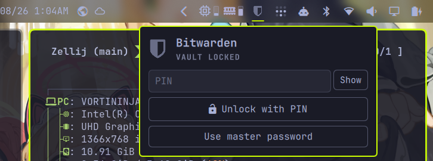
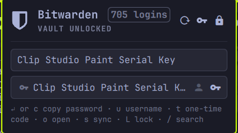

# Bitwarden — Omarchy bar widget

By **Naitrate**.

A Bitwarden vault widget for the Omarchy shell. It shows the vault state in
the bar, unlocks with your master password or a PIN, searches logins, and
copies usernames, passwords, or one-time codes without ever putting a secret
on screen.

## Screenshots





## Install

```bash
omarchy plugin add https://github.com/Naitrate/omarchy-bitwarden --enable
```

The plugin ID is `naitrate.bitwarden`. It is placed in the right bar section
by default; move it with `omarchy bar move naitrate.bitwarden --section right`.

## Remove

```bash
omarchy plugin remove naitrate.bitwarden
```

Removing the plugin does not delete the PIN entry from the system keyring.
Remove that separately if you set one:

```bash
secret-tool clear service omarchy-bitwarden account <your-email>
```

## Requirements

- `bw` (Bitwarden CLI): install the `bitwarden-cli` package with your package manager
- `jq` (already present on Omarchy)
- `wl-copy` / `wl-paste` (wl-clipboard, already present on Omarchy)
- `gpg` and `secret-tool` (already present on Omarchy) for PIN unlock

Log in once with `bw login` (the widget offers a terminal handoff), then
unlock from the panel.

## PIN unlock

While the vault is unlocked, click the key button in the panel header to set
a 6–12 digit PIN. The master password is encrypted with a key derived from the
PIN (GnuPG symmetric encryption, AES-256, high S2K count) and the ciphertext
is stored in the system keyring. The PIN itself is never stored.

After that, the locked panel asks for the PIN instead of the master password.
Use **Use master password** to fall back to the master password, **Change PIN**
to replace it, or **Remove PIN** to delete the keyring entry.

This mirrors the Bitwarden app's local PIN unlock: it is a convenience, not a
replacement for the master password. A short PIN is easier to guess if the
device and keyring are compromised, so use as many digits as you can
comfortably remember. The saved master password is only used to run
`bw unlock`; it never reaches QML and is never written in plaintext.

## Hiding the email

The account email appears in the bar tooltip and panel header. Two ways to hide
it:

- Click the eye button in the panel header to toggle it for the current shell
  session — useful before a screenshot or screen recording.
- Enable **Hide email address** in the widget settings to hide it permanently.
  From a terminal: `omarchy bar set naitrate.bitwarden hideEmail true --json`.

## Bar interactions

- **Left click** — open or close the panel
- **Right click** — lock the vault when unlocked; open the login terminal
  when logged out; otherwise open the panel
- **Middle click** — refresh status (and load the vault when unlocked)

## Panel

- **Locked** — enter your PIN, or choose **Use master password**.
- **Unlocked** — type to search; `Enter` copies the selected password.
- `c` copy password · `u` copy username · `t` copy one-time code ·
  `o` open website · `s` sync · `L` lock · `r` refresh · `/` search
- `j` / `k` or the arrow keys move the selection; `Esc` closes.

Copied passwords and codes are marked sensitive with `wl-copy --sensitive`
and cleared after the configured delay (30 seconds by default) if the
clipboard still holds them. Change the delay under the widget's settings.

## Security notes

- The session key lives only in the shared service's memory. It is never
  written to disk and is dropped when the vault locks.
- Vault data is filtered through `filter.jq` before it reaches QML, so
  passwords, notes, TOTP seeds, cards, and identities are never held by the
  widget.
- Password and TOTP copies run as `bw … | wl-copy`, so the secret goes from
  the CLI to the clipboard without passing through QML.
- PIN unlock stores an encrypted master password in the OS keyring, never the
  PIN and never a plaintext master password. The decrypted master password is
  used only inside `pin.py` to run `bw unlock`; it does not reach QML.
- Dynamic text from the vault and from `bw` is rendered as plain text.
- Only `http(s)` URLs are opened.

## Icon

The bar and panel use the official Bitwarden shield from the
[bitwarden/brand](https://github.com/bitwarden/brand) repository, painted
through a mask with the bar's foreground color so it matches the other bar
icons exactly. The colored app icon is kept as `bitwarden.svg` for reference.

## Files

- `manifest.json` — plugin declaration (`service` + `bar-widget`)
- `Service.qml` — shared vault session, CLI processes, clipboard handling
- `BarWidget.qml` — bar icon and keyboard panel
- `Model.js` — parsing, filtering, URL validation, error classification
- `filter.jq` — strips secrets from `bw list items`
- `pin.py` — encrypts/decrypts the master password for PIN unlock
- `bitwarden-shield.svg` — official shield used as the mask
- `bitwarden.svg` — official colored app icon (reference)
- `i18n/en.json` — UI strings
- `tests/pin_test.py` — PIN validation and crypto round-trip checks

## License

MIT. See [LICENSE](LICENSE). Copyright (c) 2026 Naitrate.
